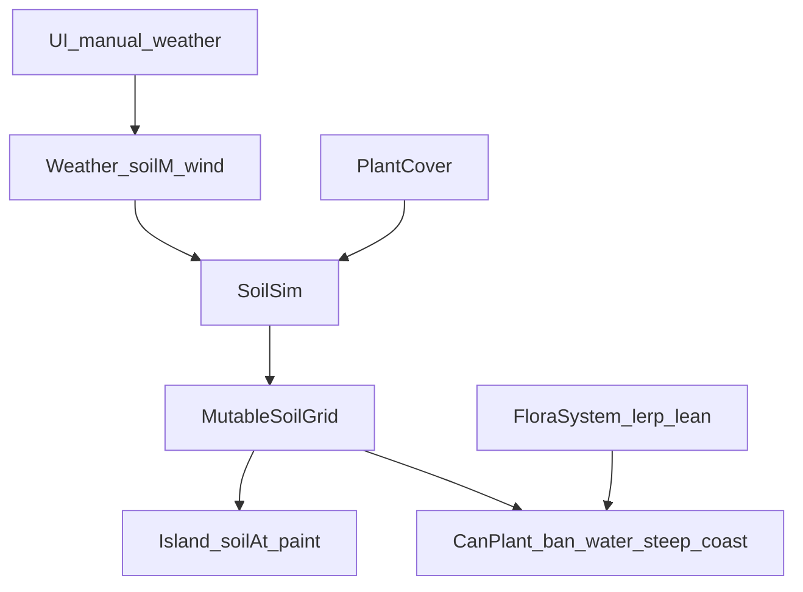

# Design: ewolucja gleby + polish (wiatr, UI, brzegi)

Data: 2026-11-15.  
Status: zatwierdzony w burzy mózgów (podejście A).

## Cel

Siatka gleby ma się powoli zmieniać w Mixed (wilgoć, wiatr, rośliny), bez hydrologii i bez przebudowy heightmapy. Równolegle: wygładzenie pochylenia wiatrem, ręczna edycja pogody przy wyłączonym auto, zakaz sadzenia na wodzie/stromiźnie/brzegu, gładsze malowanie gruntu.

## Poza zakresem

- Nowe jeziorka / zalewanie / przelew
- Zmiana reliefu (doliny, erozja terenu)
- Siatka pogodowa 2D
- Nowe modele roślin i animacje opadu liści/śniegu

## Architektura

## Dane

- `Island.soilGrid` (`Uint8Array`) — indeks typu: Grassland / Sand / Rock / Water
- `Island.soilProgress` (`Float32Array`) — postęp 0…1 do następnego typu
- Start: istniejące `#classify`
- Ewolucja **tylko** gdy `soilMode === Mixed`; Sand/Rock = override jak dziś (siatka nie mutuje pod UI)
- Komórki startowo `Water` (morze, staw) **nie ewoluują**
- Memento: pełna kopia `soilGrid` + `soilProgress` (optymalizacja RLE później, jeśli historia będzie za ciężka)

## Reguły przejść

Lokalne wejścia na komórkę: globalne `soilMoisture` + bonus stawu + cover roślin − erozja wiatrowa.

| Warunki | Kierunek |
|---|---|
| Wysoki soilM + pokrywa roślin na Rock | Rock → Grassland (wolno) |
| Niski soilM + silny wiatr + niska pokrywa na Grassland | Grassland → Sand |
| Wysoki soilM + rośliny + słaba erozja na Sand | Sand → Grassland |
| Rock bez wilgoci/roślin | bez zmian |
| Sand w długotrwałej suszy | zostaje Sand (bez Rock w tej fazie) |

Postęp zbiera się w `soilProgress`; po ≥1 następuje zmiana typu i reset postępu.  
Odświeżanie logiki co N ticków (ok. 1–2 s sim); paint gdy zmieni się wystarczająco komórek lub throttlowany.

## Sadzenie (`canPlantAt`)

Zwraca false gdy:

- `soilAt` = Water
- zbyt stromy spadek (próbka sąsiadów `heightAt`)
- w buforze brzegu morza lub stawu (odległość / shore)

Używane w: `populate`, rozsiew, imigracja (oraz eliminacja istniejących na niedozwolonym terenie — opcjonalnie stopniowo przez istniejące reguły piasku/wody).

## Polish

1. **FloraSystem:** lerp osi/kąta pochylenia od wiatru (bez skoków przy zmianie `windAngle`).
2. **UI:** przy `autoWeather === false` edytowalne: live T, airM, soilM, precip, windSpeed, windAngle. `isSnow` tylko odczyt.
3. **Paint:** blend kolorów z sąsiednich komórek gleby (+ istniejący szum), mniej „kwadratów”.

## Pliki (planowane)

| Plik | Rola |
|---|---|
| `src/config.js` | `SOIL_EVOLVE` stałe (tempa, progi, slope/coast buffer) |
| `src/environment/Island.js` | progress, evolve, canPlantAt, smooth paint, memento soil |
| `src/simulation/SimulationManager.js` | wywołanie evolve, canPlantAt, memento |
| `src/entities/FloraSystem.js` | lerp wiatru |
| `src/ui/UIManager.js` | ręczne parametry pogody |
| `tools/headless-test.mjs` | asercje ewolucji / canPlant / memento |
| `docs/CLIMATE.md` lub `docs/SOIL.md` | opis reguł |

## Kryteria akceptacji

1. Mixed: Rock + wilgoć + cover → rośnie postęp / zmiana w stronę Grassland  
2. Grassland + susza + wiatr → postęp w stronę Sand  
3. Water nie zmienia typu  
4. `canPlantAt` false na wodzie i stromym brzegu stawu/morza  
5. Memento przywraca siatkę  
6. Przy wyłączonym auto da się ustawić T/airM/soilM/precip/wiatr  
7. Zmiana kierunku wiatru nie powoduje gwałtownych skoków pochylenia  
8. `npm run build` OK  

## Kolejność po tym etapie (nie w scope)

Modele roślin, przejścia wizualne, animacje liści/śniegu; potem ewentualnie hydrologia (kałuże).
